<picture><source media="(prefers-color-scheme: dark)" srcset="assets/hero-dark.svg"></picture>

<picture><source media="(prefers-color-scheme: dark)" srcset="assets/social-l-dark.svg"></picture><a href="https://discord.com/967891235668897843"><picture><source media="(prefers-color-scheme: dark)" srcset="assets/social-1-dark.svg"></picture></a><picture><source media="(prefers-color-scheme: dark)" srcset="assets/social-r-dark.svg"></picture>

<picture><source media="(prefers-color-scheme: dark)" srcset="assets/about-dark.svg"></picture>

<picture><source media="(prefers-color-scheme: dark)" srcset="assets/stack-dark.svg"></picture>

<a href="https://github.com/sinvides/sinvides"><picture><source media="(prefers-color-scheme: dark)" srcset="assets/project-sinvides-dark.svg"></picture></a>&nbsp;<a href="https://github.com/sinvides/whyed_core"><picture><source media="(prefers-color-scheme: dark)" srcset="assets/project-whyed-core-dark.svg"></picture></a>

<a href="https://github.com/sinvides/yuki-app"><picture><source media="(prefers-color-scheme: dark)" srcset="assets/project-yuki-app-dark.svg"></picture></a>&nbsp;<a href="https://github.com/sinvides/moe-icon"><picture><source media="(prefers-color-scheme: dark)" srcset="assets/project-moe-icon-dark.svg"></picture></a>

<picture><source media="(prefers-color-scheme: dark)" srcset="assets/stats-dark.svg"></picture>

<picture><source media="(prefers-color-scheme: dark)" srcset="assets/streak-dark.svg"></picture>

<picture><source media="(prefers-color-scheme: dark)" srcset="assets/wave-dark.svg"></picture>

<a href="https://metawka.github.io/expressive-profile/?from=sinvides"><picture><source media="(prefers-color-scheme: dark)" srcset="assets/credit-dark.svg"></picture></a>

